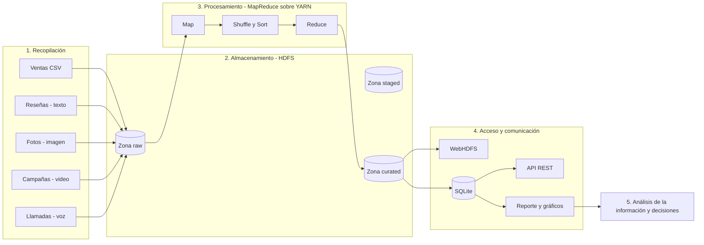

# 0. Introducción al taller

## 0.1 Contexto

Las empresas acumulan información de sus clientes en formatos muy diferentes: registros de ventas en bases de datos, reseñas escritas en aplicaciones y redes sociales, fotografías que los clientes publican, videos de campañas de mercadeo y grabaciones de las llamadas al centro de contacto. Cuando el volumen, la velocidad de generación y la variedad de formatos superan la capacidad de una base de datos tradicional, se requiere una arquitectura de **Big Data**.

En este taller el estudiante construye esa arquitectura a escala de laboratorio, siguiendo el **modelo de capas de Big Data**, y la aplica a una empresa de su propio contexto.

## 0.2 Las 5 V del Big Data

| V | Pregunta guía | Ejemplo en Café Andino S.A.S. |
|---|---|---|
| Volumen | ¿Cuántos datos se generan? | ~30.000 transacciones/año por escala, miles de reseñas, fotos y audios |
| Velocidad | ¿Con qué frecuencia llegan? | Ventas en cada minuto de apertura; publicaciones en redes en tiempo real |
| Variedad | ¿En qué formatos? | CSV, JSON, texto libre, JPG/PNG/HEIC, MP4, WAV |
| Veracidad | ¿Qué tan confiables son? | Reseñas falsas, transcripciones con errores, registros incompletos |
| Valor | ¿Qué decisión mejoran? | Detectar sucursales con problemas, campañas efectivas, motivos de reclamo |

## 0.3 Modelo de capas implementado

## 0.4 ¿Cómo se tratan las imágenes, los videos y la voz?

MapReduce procesa registros de texto. Por eso, en la práctica profesional los archivos multimedia siguen dos caminos en paralelo:

1. **El archivo original** (JPG, MP4, WAV) se almacena tal cual en la zona *raw* de HDFS, como respaldo y para futuros procesos.
2. **Su representación analizable** se obtiene con un proceso de extracción y se guarda como JSON:
   - **Imagen** → metadatos (formato, dimensiones, tamaño) + etiquetas de un modelo de visión por computador + sentimiento visual.
   - **Video** → metadatos (duración, resolución) + métricas de la plataforma (reproducciones, interacciones, retención) + transcripción del audio.
   - **Voz** → metadatos del audio (duración) + transcripción automática (*speech-to-text*) + motivo y resultado de la llamada.
   - **Texto** → se procesa directamente (tokenización, léxico de sentimiento, frecuencia de términos).

En el caso de ejemplo estas representaciones se generan de forma sintética para que el taller pueda ejecutarse en cualquier equipo. El script [`recopilacion/extraer_metadatos_multimedia.py`](../recopilacion/extraer_metadatos_multimedia.py) muestra cómo obtenerlas a partir de archivos reales.

## 0.5 Selección de la empresa

El estudiante selecciona una empresa de su entorno (local, regional o nacional) que cumpla tres condiciones:

1. Tiene una relación directa y frecuente con clientes.
2. Es plausible que genere al menos **cuatro** de los cinco tipos de datos (estructurado, texto, imagen, video, voz).
3. Existe una pregunta de negocio relevante que los datos podrían responder.

Ejemplos de sectores y fuentes multimodales:

| Sector | Estructurado | Texto | Imagen | Video | Voz |
|---|---|---|---|---|---|
| Restaurante / cafetería | Ventas por producto | Reseñas | Fotos de platos | Reels | Pedidos telefónicos |
| Clínica u odontología | Citas, facturación | Encuestas de satisfacción | Radiografías (metadatos) | Videos educativos | Llamadas de agendamiento |
| Supermercado | Tiquetes de compra | Quejas en PQRS | Fotos de góndolas | Cámaras de afluencia | Línea de atención |
| Universidad | Matrículas y notas | Evaluación docente | Carnés, eventos | Clases grabadas | Línea de admisiones |
| Operador de telecomunicaciones | Consumo y facturación | Chats de soporte | Fotos de instalaciones | Tutoriales | Llamadas de soporte |
| Concesionario de vehículos | Ventas y mantenimientos | Comentarios en redes | Fotos de peritaje | Pruebas de manejo | Llamadas comerciales |
| Hotel | Reservas | Reseñas en portales | Fotos de huéspedes | Videos promocionales | Recepción telefónica |

> **Consideración ética.** Si se utilizan datos reales de una empresa, deben estar anonimizados y contar con autorización. En Colombia aplica la Ley 1581 de 2012 de protección de datos personales. Por defecto, el taller trabaja con **datos sintéticos** que imitan el comportamiento de la empresa elegida.

## 0.6 Actividad inicial

El estudiante diligencia la sección 1 de la plantilla [`plantillas/ficha_empresa.md`](../plantillas/ficha_empresa.md), tomando como referencia la ficha resuelta de [`empresa_ejemplo/ficha_cafe_andino.md`](../empresa_ejemplo/ficha_cafe_andino.md).

---
Siguiente: [1. Recopilación de datos →](01_recopilacion.md)
