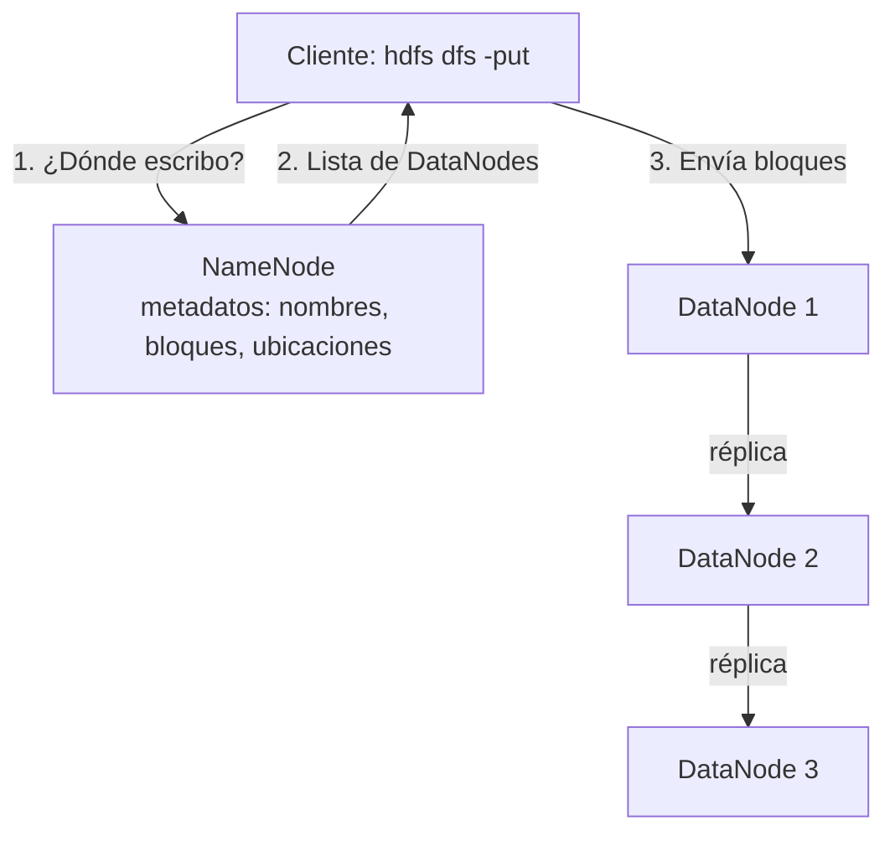

# Capa 2. Almacenamiento de datos con Apache Hadoop (HDFS)

**Propósito:** comprender la arquitectura de HDFS, operar el sistema de archivos distribuido y construir el data lake de la empresa.

**Duración estimada:** 3 horas.

**Prerrequisito:** herramientas instaladas según [`instalacion_windows.md`](instalacion_windows.md).

---

## 2.1 Conceptos clave

**HDFS (Hadoop Distributed File System)** es un sistema de archivos distribuido diseñado para almacenar archivos muy grandes en clústeres de computadores de bajo costo.



| Componente | Función |
|---|---|
| **NameNode** | Mantiene el espacio de nombres (carpetas, archivos) y el mapa de bloques. No almacena los datos. |
| **DataNode** | Almacena físicamente los bloques y reporta su estado al NameNode. |
| **Bloque** | Unidad de almacenamiento (128 MB por defecto; 32 MB en este laboratorio). |
| **Replicación** | Copias de cada bloque en distintos DataNodes (3 en producción; 1 en el laboratorio). |
| **YARN** | Gestor de recursos que asigna memoria y CPU a los trabajos (ResourceManager + NodeManager). |

En este taller se usa un **clúster pseudo-distribuido**: todos los servicios corren en el mismo computador con Windows, cada uno en su propio proceso (una ventana de consola por servicio), pero se comunican por red como si fueran nodos independientes.

## 2.2 Inicio del clúster

En **PowerShell como administrador**, desde la carpeta del repositorio:

```powershell
cd C:\taller-big-data-hadoop
.\instalacion\iniciar_hadoop.cmd
```

Se abren cinco ventanas de consola, una por servicio. Al final de la ventana principal debe aparecer:

```text
== Procesos Java activos ==
10244 NameNode
11320 DataNode
9876 ResourceManager
12004 NodeManager
8812 JobHistoryServer
7720 Jps
```

Verificación en el navegador:

- http://localhost:9870 → *Overview* del NameNode. En **Datanodes** debe aparecer 1 nodo *In Service*.
- http://localhost:8088 → ResourceManager de YARN. En **Nodes** debe aparecer 1 nodo *RUNNING*.

> Cada ventana muestra el registro (*log*) de su servicio. Cuando un trabajo falla, la causa suele aparecer en la ventana del NodeManager.

### Revisión de la configuración

El estudiante abre los archivos de `C:\hadoop\etc\hadoop\` (copiados desde [`instalacion/conf/`](../instalacion/conf)) e identifica:

| Archivo | Propiedad | Valor | Significado |
|---|---|---|---|
| core-site.xml | `fs.defaultFS` | `hdfs://localhost:9000` | Dirección del NameNode |
| hdfs-site.xml | `dfs.namenode.name.dir` | `file:///C:/hadoop/data/dfs/namenode` | Carpeta de Windows donde el NameNode guarda los metadatos |
| hdfs-site.xml | `dfs.datanode.data.dir` | `file:///C:/hadoop/data/dfs/datanode` | Carpeta de Windows donde el DataNode guarda los bloques |
| hdfs-site.xml | `dfs.replication` | `1` | Número de copias de cada bloque |
| hdfs-site.xml | `dfs.blocksize` | `33554432` | Tamaño de bloque (32 MB) |
| mapred-site.xml | `mapreduce.framework.name` | `yarn` | MapReduce se ejecuta sobre YARN |
| yarn-site.xml | `yarn.nodemanager.aux-services` | `mapreduce_shuffle` | Habilita la fase de *shuffle* |

**Actividad:** abrir en el Explorador de Windows la carpeta `C:\hadoop\data\dfs\datanode\current\` después de cargar los datos (sección 2.4) y localizar los archivos `blk_...`. Son los bloques físicos de HDFS: el usuario ve archivos completos en `/datalake`, pero en disco están divididos en bloques.

## 2.3 Práctica guiada de comandos HDFS

En PowerShell, desde `C:\taller-big-data-hadoop`:

```powershell
# Estado general del sistema de archivos
hdfs dfsadmin -report

# Crear una carpeta de práctica, subir un archivo y consultarlo
hdfs dfs -mkdir -p /practica
hdfs dfs -put datos\raw\sucursales.csv /practica/
hdfs dfs -ls /practica
hdfs dfs -cat /practica/sucursales.csv
hdfs dfs -tail /practica/sucursales.csv

# Copiar, mover, consultar tamaño, descargar y eliminar
hdfs dfs -cp /practica/sucursales.csv /practica/copia.csv
hdfs dfs -mv /practica/copia.csv /practica/sucursales_backup.csv
hdfs dfs -du -h /practica
hdfs dfs -get /practica/sucursales_backup.csv $env:TEMP\
hdfs dfs -rm -r /practica
```

> Las rutas **locales** de Windows usan `\` (`datos\raw\sucursales.csv`); las rutas de **HDFS** usan siempre `/` (`/practica/`).

| Comando | Equivalente en Windows | Función |
|---|---|---|
| `hdfs dfs -ls` | `dir` | Listar |
| `hdfs dfs -mkdir -p` | `mkdir` | Crear carpetas |
| `hdfs dfs -put` / `-get` | `copy` (local ↔ HDFS) | Subir / descargar |
| `hdfs dfs -cat` / `-tail` | `type` | Ver contenido |
| `hdfs dfs -du -h` | Propiedades → Tamaño | Espacio utilizado |
| `hdfs dfs -rm -r` | `rmdir /s` | Eliminar |
| `hdfs fsck <ruta> -files -blocks` | — | Ver bloques y réplicas |

## 2.4 Construcción del data lake

El script [`scripts/01_cargar_hdfs.ps1`](../scripts/01_cargar_hdfs.ps1) crea las zonas `raw`, `staged` y `curated` y carga cada fuente en su carpeta, según el diseño de [`modelo_datos/organizacion_data_lake.md`](../modelo_datos/organizacion_data_lake.md). Las rutas se leen de [`scripts/trabajos.json`](../scripts/trabajos.json).

```powershell
.\scripts\01_cargar_hdfs.ps1
```

Salida esperada (fragmento):

```text
== Creando zonas del data lake ==

== Cargando datos en la zona raw ==
  clientes.csv                 ->  /datalake/raw/estructurados/clientes
  transacciones.csv            ->  /datalake/raw/estructurados/transacciones
  resenas.jsonl                ->  /datalake/raw/texto/resenas
  imagenes.jsonl               ->  /datalake/raw/imagen/metadatos
  ...
== Espacio utilizado ==
...
== Bloques y réplicas del archivo de transacciones ==
```

Verificación en la interfaz web: **Utilities → Browse the file system** → `/datalake/raw`.

## 2.5 Experimento: bloques y escalabilidad

1. Generar un volumen mayor de datos y recargarlo:

   ```powershell
   python recopilacion\generar_datos.py --escala 20
   .\scripts\01_cargar_hdfs.ps1
   ```

2. Consultar en cuántos bloques quedó dividido el archivo de transacciones:

   ```powershell
   hdfs fsck /datalake/raw/estructurados/transacciones -files -blocks -locations
   ```

3. Registrar en el informe: tamaño del archivo, número de bloques, tamaño de cada bloque y relación con `dfs.blocksize`. Comparar con la cantidad de archivos `blk_...` en `C:\hadoop\data\dfs\datanode\current\`.

4. Volver a la escala 1 para el resto del taller (más rápido):

   ```powershell
   python recopilacion\generar_datos.py
   .\scripts\01_cargar_hdfs.ps1
   ```

**Preguntas de control:**

1. Si el clúster tuviera 3 DataNodes y replicación 3, ¿cuánto espacio físico ocuparía un archivo de 100 MB?
2. ¿Qué ocurriría con los datos si falla el único DataNode del laboratorio? ¿Y en un clúster de producción?
3. ¿Por qué HDFS no es adecuado para millones de archivos muy pequeños (por ejemplo, miniaturas de imágenes de 5 KB)? ¿Qué alternativa se podría usar?
4. ¿Qué diferencia hay entre la carpeta `C:\hadoop\data\dfs\datanode` (Windows) y la carpeta `/datalake` (HDFS)?

## Evidencias de esta capa

- [ ] Captura de las ventanas de los servicios y de la salida de `jps`.
- [ ] Captura de la página *Datanodes* del NameNode (http://localhost:9870).
- [ ] Captura del explorador de archivos web mostrando `/datalake/raw` con sus subcarpetas.
- [ ] Salida de `hdfs fsck` del experimento de bloques, con su interpretación.
- [ ] Respuestas a las preguntas de control.

---
[← 1. Recopilación](01_recopilacion.md) | Siguiente: [3. Procesamiento con MapReduce →](03_procesamiento_mapreduce.md)
