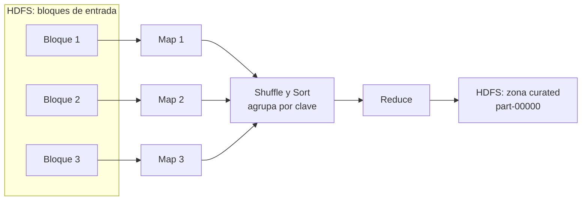

# Capa 3. Análisis y procesamiento de datos con MapReduce

**Propósito:** transformar los datos crudos del data lake en indicadores, mediante trabajos MapReduce ejecutados en paralelo sobre YARN.

**Duración estimada:** 4 horas.

---

## 3.1 Modelo de programación MapReduce

MapReduce divide un problema en dos funciones que el programador escribe y una fase intermedia que Hadoop ejecuta automáticamente:



| Fase | Quién la implementa | Qué hace | Ejemplo (ventas por ciudad) |
|---|---|---|---|
| **Map** | Estudiante (`mapper.py`) | Lee cada registro y emite pares `clave → valor` | `T001,…,Cali,…,37500` → `Cali\|postres  37500  3` |
| **Combine** (opcional) | Estudiante | Pre-agrega en cada nodo para reducir tráfico de red | Suma parcial por clave en el mismo mapper |
| **Shuffle & Sort** | Hadoop | Envía todos los pares con la misma clave al mismo reducer, ordenados | `Cali\|postres` → [37500, 9500, 25000, …] |
| **Reduce** | Estudiante (`reducer.py`) | Agrega los valores de cada clave | `Cali\|postres  293  482  5308000  18116` |

### Hadoop Streaming

Hadoop está escrito en Java, pero **Hadoop Streaming** permite escribir el mapper y el reducer en cualquier lenguaje que lea de la entrada estándar (`stdin`) y escriba en la salida estándar (`stdout`). La convención es:

- Cada línea emitida es un par `clave<TAB>valor`.
- Todo lo que está antes del primer tabulador es la **clave**.
- El reducer recibe las líneas **ordenadas por clave**, por lo que debe detectar cuándo cambia la clave.

Conceptualmente, un trabajo de Streaming equivale a la siguiente tubería, que imita las tres fases:

```text
leer entrada  →  python mapper.py  →  ordenar por clave  →  python reducer.py  →  salida
```

En Windows esta simulación se ejecuta con [`scripts/probar_local.py`](../scripts/probar_local.py), que pasa los datos por el mapper, ordena por clave como lo hace Hadoop y entrega el resultado al reducer.

## 3.2 Trabajos incluidos en el caso de ejemplo

| # | Trabajo | Modalidad | Entrada (HDFS) | Clave | Indicadores |
|---|---|---|---|---|---|
| 1 | `job1_ventas` | Estructurado | transacciones | ciudad\|categoría, mes, sucursal… (variable `DIMENSION`) | transacciones, unidades, ventas, ticket promedio |
| 2 | `job2_sentimiento` | **Texto + Voz** | reseñas + llamadas | fuente\|sucursal | positivos, negativos, neutros, índice neto |
| 3 | `job3_palabras` | **Texto + Voz + Video** | reseñas, llamadas, videos | palabra o bigrama | frecuencia |
| 4 | `job4_imagenes` | **Imagen** | metadatos de imágenes | etiqueta (o ciudad\|etiqueta) | n.º imágenes, sentimiento visual, % marca |
| 5 | `job5_videos` | **Video** | metadatos de videos | campaña\|plataforma | reproducciones, engagement, retención |
| 6 | `job6_llamadas` | **Voz** | llamadas | motivo (o sucursal, hora) | n.º llamadas, duración media, % resueltas |

Las combinaciones concretas que se ejecutan (11 salidas) están declaradas en [`scripts/trabajos.json`](../scripts/trabajos.json).

## 3.3 Lectura guiada del código: Job 1 (ventas)

**Mapper** — [`mapreduce/job1_ventas/mapper.py`](../mapreduce/job1_ventas/mapper.py):

```python
for fila in csv.reader(sys.stdin):
    if not fila or fila[0] == "id_transaccion":      # omite el encabezado
        continue
    ... = fila                                       # desempaqueta las columnas
    clave = f"{ciudad}|{categoria}"                  # clave compuesta
    print(f"{clave}\t{valor_total}\t{cantidad}")     # par clave -> valor
```

Aspectos a resaltar:

- La clave compuesta usa `|` en lugar de tabulador, porque Streaming toma como clave solo lo que está antes del primer tabulador.
- Las filas inválidas no detienen el trabajo: se cuentan con un **contador de Hadoop** (`reporter:counter:Calidad,Filas_invalidas,1`), visible en la interfaz de YARN.
- La dimensión de agrupación se parametriza con una **variable de entorno** (`-cmdenv DIMENSION=mes`), lo que permite reutilizar el mismo código para varios análisis.
- Al inicio, `sys.stdout.reconfigure(encoding="utf-8", newline="\n")` obliga a Python en Windows a escribir en UTF-8 y con saltos de línea `\n`, que es lo que espera Hadoop (Windows usaría `\r\n` por defecto).

**Reducer** — [`mapreduce/job1_ventas/reducer.py`](../mapreduce/job1_ventas/reducer.py):

```python
for linea in sys.stdin:                     # líneas ordenadas por clave
    clave, valor, cantidad = linea.split("\t")
    if clave != clave_actual:               # cambió la clave: se emite el grupo anterior
        emitir()
        clave_actual, n, unidades, ventas = clave, 0, 0, 0
    n += 1; unidades += int(cantidad); ventas += int(valor)
emitir()                                    # no olvidar el último grupo
```

## 3.4 Paso 1: prueba local (sin Hadoop)

Antes de enviar un trabajo al clúster se verifica localmente. Desde `C:\taller-big-data-hadoop`:

```powershell
# Ver las primeras líneas que emite el mapper (fase map) y el resultado
python scripts\probar_local.py --ver-map ventas_mes

# Un trabajo cambiando una variable de entorno
python scripts\probar_local.py ventas_mes DIMENSION=medio_pago

# Los once trabajos
python scripts\probar_local.py
```

Salida esperada (fragmento):

```text
>> ventas_ciudad_categoria    map:   30000 pares | claves:   25 | salida: resultados\local\ventas_ciudad_categoria.tsv
>> sentimiento_sucursal       map:    7500 pares | claves:   14 | salida: resultados\local\sentimiento_sucursal.tsv
...
```

Los resultados quedan en `resultados\local\`. Si un trabajo falla aquí, también fallará en Hadoop; el mensaje de error de Python indica el archivo y la línea.

## 3.5 Paso 2: ejecución en Hadoop

### Ejecución de un trabajo de forma manual

Con Hadoop iniciado, en PowerShell como administrador:

```powershell
cd C:\taller-big-data-hadoop\mapreduce
$JAR = (Get-ChildItem "$env:HADOOP_HOME\share\hadoop\tools\lib\hadoop-streaming-*.jar").FullName

hadoop jar $JAR `
  -D '"mapreduce.job.name=ventas-por-mes"' `
  -files '"job1_ventas/mapper.py,job1_ventas/reducer.py"' `
  -mapper '"python mapper.py"' `
  -reducer '"python reducer.py"' `
  -cmdenv '"DIMENSION=mes"' `
  -cmdenv '"PYTHONIOENCODING=utf-8"' `
  -input /datalake/raw/estructurados/transacciones `
  -output /datalake/curated/ventas_mes_manual

hdfs dfs -ls /datalake/curated/ventas_mes_manual
hdfs dfs -cat /datalake/curated/ventas_mes_manual/part-00000
cd ..
```

> **¿Por qué `'"..."'`?** En Windows, `hadoop` es un archivo por lotes (`hadoop.cmd`) que separa los argumentos al encontrar `=`, `,` o espacios. Encerrar el valor entre comillas dobles (y estas entre comillas simples para PowerShell) evita que `mapreduce.job.name=ventas-por-mes` se parta en dos. En el *Símbolo del sistema* (cmd) bastaría con las comillas dobles: `-D "mapreduce.job.name=ventas-por-mes"`.
>
> El carácter `` ` `` al final de cada línea es la continuación de línea de PowerShell.

| Opción | Función |
|---|---|
| `-D clave=valor` | Propiedades del trabajo (nombre, número de reducers, etc.) |
| `-files` | Archivos que Hadoop copia a cada nodo (scripts, léxicos, utilidades); rutas relativas a la carpeta actual |
| `-mapper`, `-reducer`, `-combiner` | Comando que se ejecuta en cada fase |
| `-cmdenv` | Variables de entorno para los scripts |
| `-input` | Carpeta(s) de entrada en HDFS (se puede repetir) |
| `-output` | Carpeta de salida; **no debe existir** previamente |

> Si la carpeta de salida ya existe, el trabajo termina con `Output directory ... already exists`. Se elimina con `hdfs dfs -rm -r /datalake/curated/ventas_mes_manual`.

### Ejecución de todos los trabajos

```powershell
.\scripts\02_ejecutar_mapreduce.ps1
# uno o varios trabajos:
.\scripts\02_ejecutar_mapreduce.ps1 -Trabajo sentimiento_sucursal
.\scripts\02_ejecutar_mapreduce.ps1 -Trabajo ventas_mes,llamadas_motivo
```

> **Modo local.** Si YARN presenta problemas en un equipo (ver [anexo de solución de problemas](anexo_solucion_problemas.md)), los trabajos pueden ejecutarse con `-Modo local`. En ese modo MapReduce corre dentro de un solo proceso, sin ResourceManager ni NodeManager, pero **sigue leyendo y escribiendo en HDFS**:
>
> ```powershell
> .\scripts\02_ejecutar_mapreduce.ps1 -Modo local
> ```
>
> Se recomienda comparar los tiempos de ambos modos y explicar la diferencia en el informe.

### Lectura del registro de ejecución

Al finalizar cada trabajo, Hadoop imprime contadores. Los más importantes:

```text
Job Counters
    Launched map tasks=1              ← número de mappers (≈ número de bloques de entrada)
    Launched reduce tasks=1
Map-Reduce Framework
    Map input records=30001           ← líneas leídas
    Map output records=30000          ← pares emitidos por el map
    Combine input records=...         ← solo si hay combiner
    Reduce input groups=25            ← claves distintas
    Reduce output records=25          ← líneas del resultado
```

### Monitoreo en la interfaz web

- http://localhost:8088 → lista de aplicaciones, estado y progreso de map y reduce.
- http://localhost:19888 → historial: duración de cada tarea, contadores, registros (*logs*) de errores de Python.

## 3.6 Resultados esperados del caso de ejemplo

Con los datos generados por defecto (semilla 2025, escala 1), el estudiante debe obtener resultados como los siguientes:

**`sentimiento_sucursal`** (fragmento, fuente texto):

```text
texto_resena|S03	878	751	85	42	2.090	0.759
texto_resena|S05	891	239	541	111	-1.357	-0.339
```

**`llamadas_motivo`** (fragmento):

```text
falla_aplicacion	331	478	48.6	44.0
pedido_tardio	466	424	62.7	54.9
```

Si los valores difieren, debe verificarse que la semilla y la escala sean las mismas.

## 3.7 Ejercicios

### Ejercicio 1 (obligatorio): variar dimensiones con `-cmdenv`

Ejecutar manualmente en Hadoop (sección 3.5) el Job 1 con `-cmdenv '"DIMENSION=medio_pago"'` y el Job 6 con `-cmdenv '"DIMENSION=hora"'`, después de comprobarlos con `probar_local.py`. Interpretar: ¿qué medio de pago predomina? ¿A qué hora se concentran las llamadas?

### Ejercicio 2 (obligatorio): efecto del combiner

Ejecutar `palabras_frecuentes` con y sin combiner (cambiar `"combiner": true` por `false` en `scripts\trabajos.json`, o agregar/quitar `-combiner '"python reducer.py"'` en la ejecución manual) y comparar los contadores `Map output records`, `Combine output records` y `Reduce shuffle bytes`. Explicar por qué el combiner reduce el tráfico de red y por qué **no** se puede usar en el Job 2 tal como está escrito (pista: el reducer calcula promedios).

### Ejercicio 3 (obligatorio): nuevo trabajo MapReduce

Diseñar e implementar un trabajo **propio** que responda una pregunta de negocio de la empresa seleccionada. Ideas para el caso de ejemplo:

- Calificación promedio por canal de publicación de la reseña (`app`, `google_maps`, …).
- Ventas por franja horaria (mañana, tarde, noche) y día de la semana.
- Duración promedio de los videos por plataforma y su relación con la retención.
- Porcentaje de imágenes con `menciona_marca` por origen.

Pasos: (1) definir clave y valor, (2) escribir `mapper.py` y `reducer.py` en una carpeta `mapreduce\job7_<nombre>\` (se puede copiar uno existente como punto de partida, conservando las líneas `reconfigure`), (3) agregar el trabajo en la lista `"trabajos"` de `scripts\trabajos.json`, (4) probarlo con `python scripts\probar_local.py <nombre>`, (5) ejecutarlo en Hadoop con `.\scripts\02_ejecutar_mapreduce.ps1 -Trabajo <nombre>` y (6) agregar sus columnas en `acceso\esquema_resultados.py` para que llegue a la base de datos.

### Ejercicio 4 (reto): unión de fuentes (*reduce-side join*)

Calcular las ventas por **segmento de cliente** (estudiante, profesional, …). El segmento está en `clientes.csv` y las ventas en `transacciones.csv`, por lo que se necesita unir ambas fuentes:

- El mapper recibe ambos archivos (dos `-input`) y emite `id_cliente → C,<segmento>` para clientes y `id_cliente → T,<valor>` para transacciones.
- El reducer recibe, para cada cliente, su segmento y todas sus compras, y emite `segmento → valor`.
- Un segundo trabajo (o un `sort` + suma) agrega por segmento.

### Ejercicio 5 (reto): mejorar el análisis de sentimiento

El léxico ([`mapreduce/comun/lexico_sentimiento.txt`](../mapreduce/comun/lexico_sentimiento.txt)) no incluye la palabra `frio`, porque es ambigua: "el café llegó **frío**" es negativo, pero "recomiendo el café **frío** de la casa" es positivo. Proponer y probar una mejora (por ejemplo, puntuar bigramas como `llego_frio`) y comparar el índice neto antes y después.

## Evidencias de esta capa

- [ ] Captura de la ejecución de al menos un trabajo en consola (con contadores).
- [ ] Captura de la lista de aplicaciones en YARN (http://localhost:8088) con los trabajos en estado *SUCCEEDED*.
- [ ] Captura de `hdfs dfs -ls /datalake/curated`.
- [ ] Código y resultado del trabajo propio (Ejercicio 3).
- [ ] Tabla comparativa del Ejercicio 2.

---
[← 2. Almacenamiento](02_almacenamiento_hadoop.md) | Siguiente: [4. Acceso y comunicación →](04_acceso_comunicacion.md)
