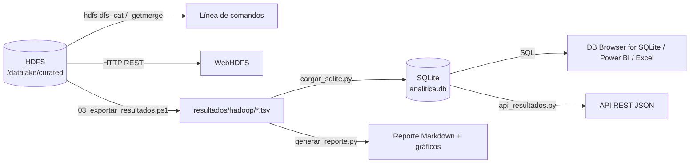
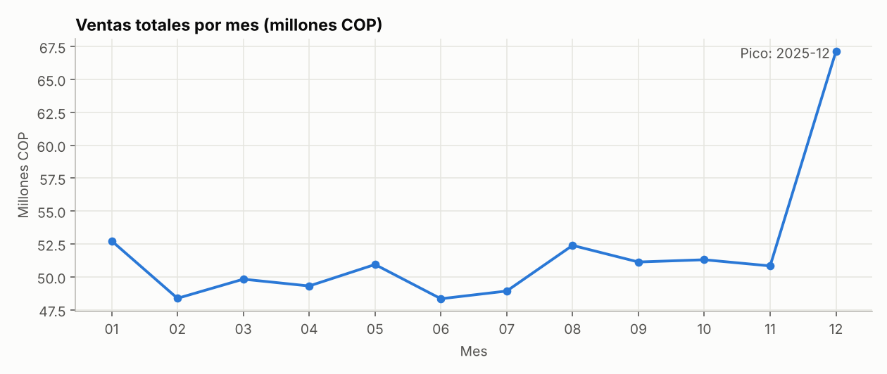
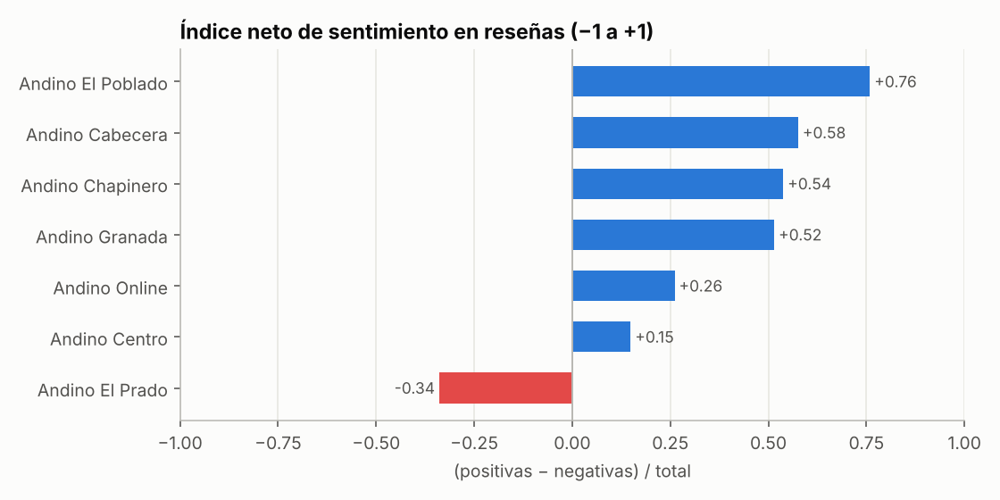
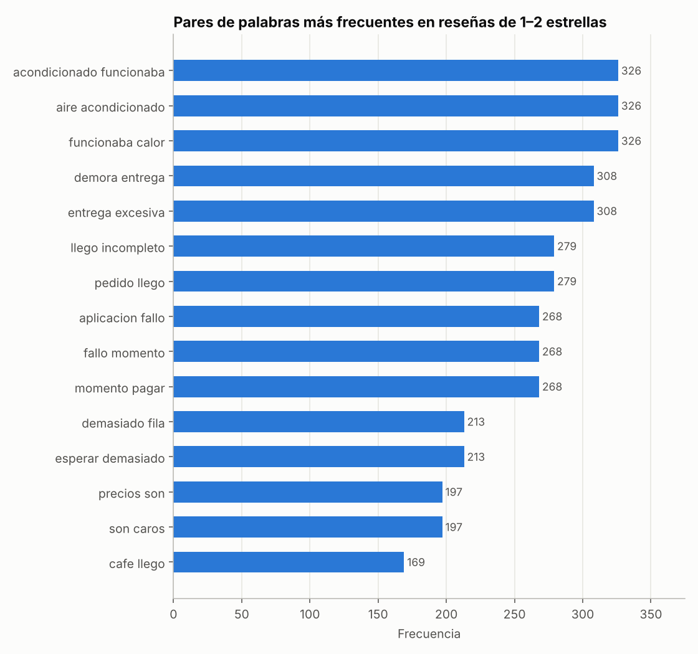
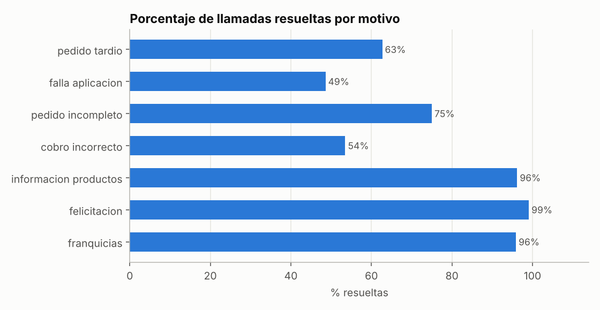

# Capa 4. Acceso a los datos y comunicación

**Propósito:** poner los resultados del procesamiento a disposición de personas y aplicaciones mediante diferentes mecanismos de acceso.

**Duración estimada:** 2 horas.

---

## 4.1 Mecanismos de acceso implementados



| Mecanismo | Usuario típico | Ventaja |
|---|---|---|
| Línea de comandos HDFS | Ingeniero de datos | Acceso directo, sin intermediarios |
| WebHDFS (REST) | Aplicaciones externas | No requiere instalar Hadoop en el cliente |
| Base de datos SQL | Analista de negocio | Consultas flexibles y conexión con herramientas BI |
| API REST | Desarrolladores (apps, tableros web) | Formato JSON estándar |
| Reporte con gráficos | Gerencia | Comunicación directa de hallazgos |

## 4.2 Acceso por línea de comandos

```powershell
hdfs dfs -ls /datalake/curated
hdfs dfs -cat /datalake/curated/llamadas_motivo/part-00000
```

Exportar todos los resultados a la carpeta `resultados\hadoop\` del repositorio:

```powershell
.\scripts\03_exportar_resultados.ps1
```

## 4.3 Acceso mediante WebHDFS (API REST de Hadoop)

WebHDFS permite operar HDFS con peticiones HTTP, desde cualquier lenguaje o herramienta, sin instalar Hadoop en el cliente. El script [`scripts/webhdfs_ejemplos.ps1`](../scripts/webhdfs_ejemplos.ps1) contiene cuatro ejemplos con PowerShell:

```powershell
.\scripts\webhdfs_ejemplos.ps1
```

Peticiones individuales (también pueden pegarse en el navegador):

```powershell
# Listar resultados
Invoke-RestMethod "http://localhost:9870/webhdfs/v1/datalake/curated?op=LISTSTATUS"

# Leer un resultado con curl.exe, incluido en Windows 10/11 (-L sigue la redirección al DataNode)
curl.exe -s -L "http://localhost:9870/webhdfs/v1/datalake/curated/ventas_mes/part-00000?op=OPEN"
```

**Pregunta de control:** ¿por qué la operación `OPEN` responde con una redirección (HTTP 307) en lugar de entregar directamente el contenido? Relacionarlo con los roles del NameNode y del DataNode.

## 4.4 Carga en una base de datos analítica (SQL)

```powershell
python acceso\cargar_sqlite.py
```

El script crea `resultados/analitica.db` con una tabla por resultado, las dimensiones `dim_sucursal` y `dim_producto`, y la vista **`v_tablero_sucursal`**, que integra en una sola fila por sucursal información de ventas (estructurado), reseñas (texto) y llamadas (voz):

```text
id_sucursal | nombre            | ciudad       | ventas_totales | sentimiento_resenas | n_llamadas | pct_resueltas
S03         | Andino El Poblado | Medellín     | 83102000       | 0.759               | 230        | 72.2
...
S05         | Andino El Prado   | Barranquilla | 79069500       | -0.339              | 226        | 65.9
```

Para consultar la base de datos se usa **DB Browser for SQLite**: *Abrir base de datos* → `C:\taller-big-data-hadoop\resultados\analitica.db` → pestaña **Ejecutar SQL**. Consultas de práctica:

```sql
-- Top 3 combinaciones ciudad-categoría por ventas
SELECT ciudad, categoria, ventas_totales
FROM ventas_ciudad_categoria
ORDER BY ventas_totales DESC LIMIT 3;

-- Sucursales cuyo sentimiento en voz es peor que en texto
SELECT t.id_sucursal, t.indice_neto AS texto, v.indice_neto AS voz
FROM sentimiento_sucursal t
JOIN sentimiento_sucursal v ON v.id_sucursal = t.id_sucursal AND v.fuente = 'voz_llamada'
WHERE t.fuente = 'texto_resena'
ORDER BY t.indice_neto - v.indice_neto DESC;

-- Motivos de llamada con resolución inferior al 60 %
SELECT motivo, n_llamadas, pct_resueltas FROM llamadas_motivo WHERE pct_resueltas < 60;
```

> **Conexión con Power BI o Excel:** los archivos `resultados\hadoop\*.tsv` se importan con *Obtener datos → Texto/CSV*, eligiendo el delimitador **Tabulación** y el origen **65001: Unicode (UTF-8)**. SQLite también puede conectarse mediante un controlador ODBC para SQLite.

## 4.5 Comunicación mediante una API REST

```powershell
python acceso\api_resultados.py
```

Dejar esa ventana abierta y probar desde el navegador o desde otra ventana de PowerShell:

```powershell
Invoke-RestMethod "http://localhost:8000/resultados/llamadas_motivo?orden=n_llamadas&desc=1&limite=3"
```

> La primera vez, el Firewall de Windows puede solicitar permiso para Python: permitir el acceso en redes privadas.

| Petición | Respuesta |
|---|---|
| http://localhost:8000/ | Lista de recursos disponibles |
| http://localhost:8000/tablero | Vista integrada por sucursal |
| http://localhost:8000/resultados/videos_campanas?orden=tasa_engagement_pct&desc=1 | Campañas ordenadas por engagement |
| http://localhost:8000/resultados/bigramas_quejas?orden=frecuencia&desc=1&limite=10 | Diez bigramas más frecuentes en quejas |

Ejemplo de respuesta:

```json
[
  {
    "motivo": "pedido_tardio",
    "n_llamadas": 466,
    "duracion_promedio_seg": 424,
    "pct_resueltas": 62.7,
    "horas_totales": 54.9
  }
]
```

## 4.6 Reporte con gráficos

```powershell
python acceso\generar_reporte.py
```

Se genera `resultados\reporte_resultados.md` con tablas y siete gráficos en `resultados\graficos\`. El reporte se visualiza con formato en Visual Studio Code (clic derecho → *Open Preview*) o directamente en GitHub. Ejemplos del caso Café Andino:

| | |
|---|---|
|  |  |
|  |  |

## 4.7 Seguridad y gobierno del acceso

En el informe, el estudiante describe cómo se protegería el acceso en un entorno real. Elementos mínimos a considerar:

- **Autenticación** en Hadoop (Kerberos) y en la API (tokens).
- **Autorización** por zona del data lake: los analistas solo leen `curated`; solo los procesos de ingesta escriben en `raw`.
- **Anonimización**: los resultados agregados no exponen datos personales; los identificadores de cliente son seudónimos.
- **Cumplimiento legal**: Ley 1581 de 2012 (Colombia) o la normativa del país correspondiente.

## Evidencias de esta capa

- [ ] Salida de `webhdfs_ejemplos.ps1` (o capturas de las peticiones en el navegador).
- [ ] Captura de DB Browser for SQLite con la vista `v_tablero_sucursal` y dos consultas SQL propias.
- [ ] Captura del navegador consumiendo la API.
- [ ] Reporte `reporte_resultados.md` con los gráficos generados.
- [ ] Propuesta de seguridad y gobierno del acceso.

---
[← 3. Procesamiento](03_procesamiento_mapreduce.md) | Siguiente: [5. Análisis de resultados →](05_analisis_resultados.md)
