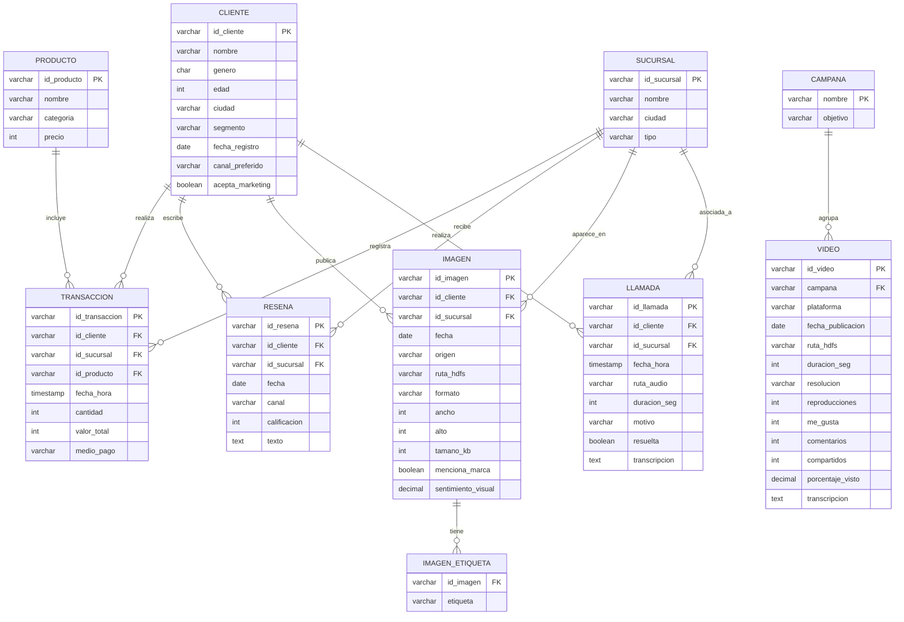

# Diagrama entidad–relación de la base de datos multimodal de clientes

El modelo gira alrededor de la entidad **CLIENTE**. Cada modalidad de dato (texto, imagen, video, voz) se representa con una entidad propia que guarda los **metadatos y la representación analizable**, mientras que el archivo original se referencia mediante su ruta en HDFS (`ruta_hdfs` / `ruta_audio`).

## Modelo relacional vs. modelo en el data lake

| Aspecto | Base de datos relacional (diseño lógico) | Data lake en HDFS (implementación) |
|---|---|---|
| Esquema | Se define antes de cargar (*schema-on-write*) | Se interpreta al leer (*schema-on-read*) |
| Formato | Tablas normalizadas | CSV y JSON Lines (un registro por línea) |
| Relaciones | Llaves foráneas | Identificadores compartidos (`id_cliente`, `id_sucursal`) |
| Desnormalización | Se evita | Se acepta para facilitar el procesamiento (ej. `ciudad` dentro de `transacciones.csv` y de `resenas.jsonl`) |
| Listas | Tabla intermedia (`IMAGEN_ETIQUETA`) | Arreglo dentro del JSON (`"etiquetas": [...]`) |
| Archivos binarios | Ruta o BLOB | Archivo original en `/datalake/raw/multimedia/` |

El archivo [`esquema_relacional.sql`](esquema_relacional.sql) contiene el DDL completo para PostgreSQL/MySQL, útil si la empresa ya opera con una base de datos transaccional desde la cual se extraerían los datos hacia Hadoop.
